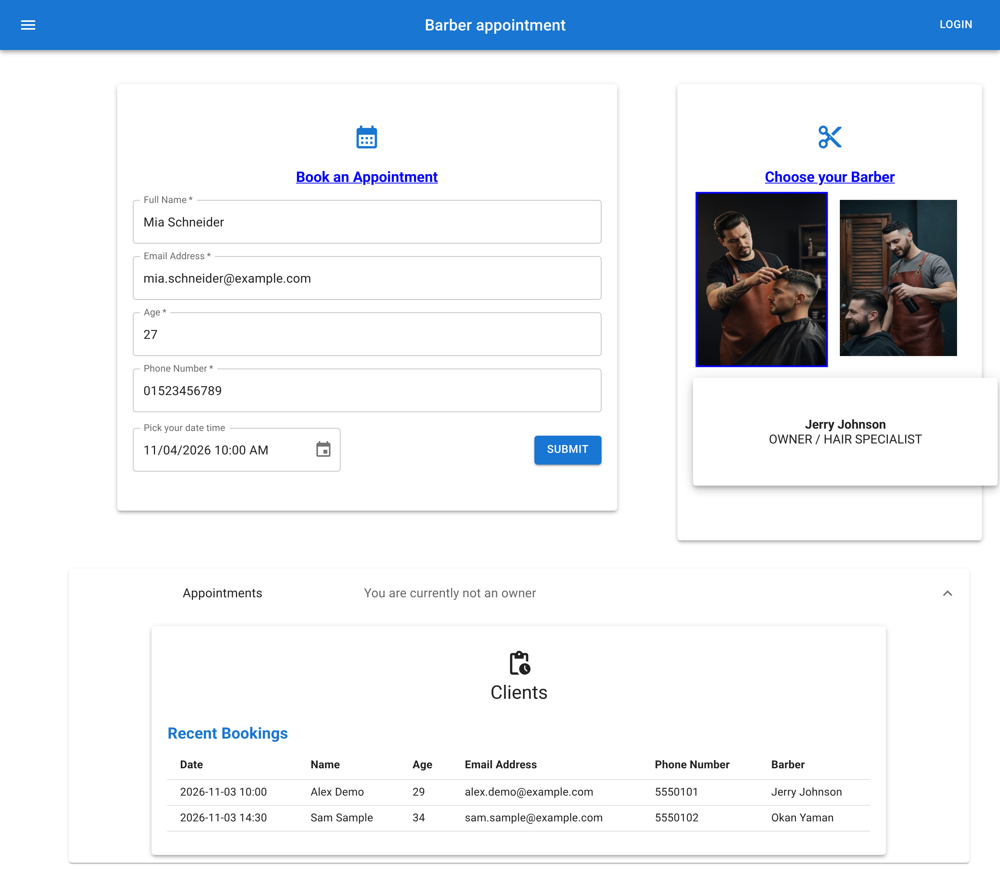

# Barber Booking App

A full stack booking app for a barber shop: a **Spring Boot** REST API with **PostgreSQL** persistence and a **React** client.

Clients pick a barber and a time slot, book with an account or as a guest, and see the shop's bookings. The shop owner signs in to manage appointments.



**Status:** Complete portfolio project. It runs locally and has no hosted demo.

## Capabilities

- **Client, guest, and owner flows.** Registered clients sign in and get their details pre-filled. Guests can book without an account, and a client record is created on the fly. Owner sign-in unlocks deleting appointments. Passwords are stored as BCrypt hashes and never returned by the API.
- **Double-booking guard.** The API rejects an appointment whose time slot is already reserved with `409 Conflict`. Each slot can be booked once across the shop. Duplicate email registrations are rejected the same way.
- **Validation on both sides.** The booking form checks email, age, and phone input and keeps submit disabled until it's valid. On the server, Jakarta Bean Validation rejects invalid client data with `400`.
- **Relational domain model.** Appointments link a client and a barber through JPA many-to-one relationships. Spring Data repositories persist them in PostgreSQL.
- **Consistent REST errors.** Centralised exception handling maps missing records and conflicts to `404` and `409` JSON responses.
- **Integration-tested API.** Spring Boot tests call the controllers over HTTP against a real PostgreSQL database. They cover creating, reading, deleting, validation, and booking.

## Architecture

```text
React client (Material UI, date/time picker)
        │  JSON over HTTP
        ▼
Spring Boot REST API ── clients · appointments · barbers · owner sign-in
        │  validation, conflict checks, error mapping
        ▼
Spring Data JPA
        │
        ▼
PostgreSQL
```

The frontend and backend live in one repository. The Maven project is at the root, and the React app is in `clientfrontend/`.

## Stack

| Area | Technology |
| --- | --- |
| Backend | Java, Spring Boot (Web, Data JPA, Bean Validation) |
| Database | PostgreSQL |
| Frontend | React, Material UI |
| Testing | JUnit, Spring Boot Test |
| Build | Maven, npm |

## Running locally

Prerequisites: Java 17, Node.js, and a local PostgreSQL server.

1. Create a database named `DB`, and set your PostgreSQL credentials in `src/main/resources/application.properties`.
2. Start the API from the repository root. The client expects it at `http://localhost:8080`.

   ```bash
   ./mvnw spring-boot:run
   ```

3. On a fresh database, add the two barbers and an owner account (one-time). The client expects these barbers as IDs 1 and 2.

   ```bash
   curl -H 'Content-Type: application/json' -d '{"name":"Jerry Johnson"}' localhost:8080/barber
   curl -H 'Content-Type: application/json' -d '{"name":"Okan Yaman"}' localhost:8080/barber
   curl -H 'Content-Type: application/json' -d '{"email":"owner@example.com","password":"change-me"}' localhost:8080/owner
   ```

4. Start the client and open `http://localhost:3000`:

   ```bash
   cd clientfrontend
   npm install
   npm start
   ```

The backend tests use a second local database named `test-clients`. Run them with `./mvnw test` while the API is stopped.

## Scope

Sign-in is a simple demo flow without sessions or tokens. The project focuses on the booking domain, the REST API, and persistence.
